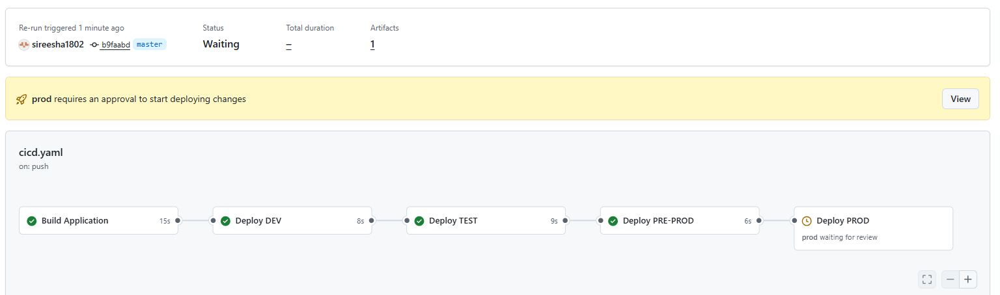
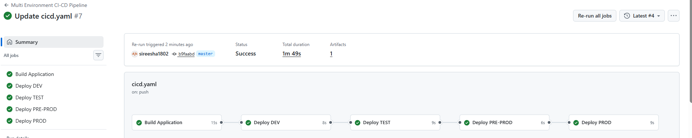
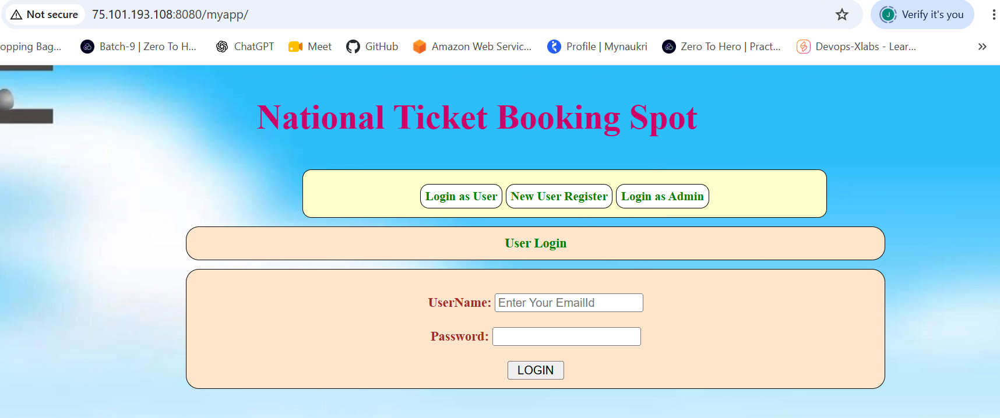
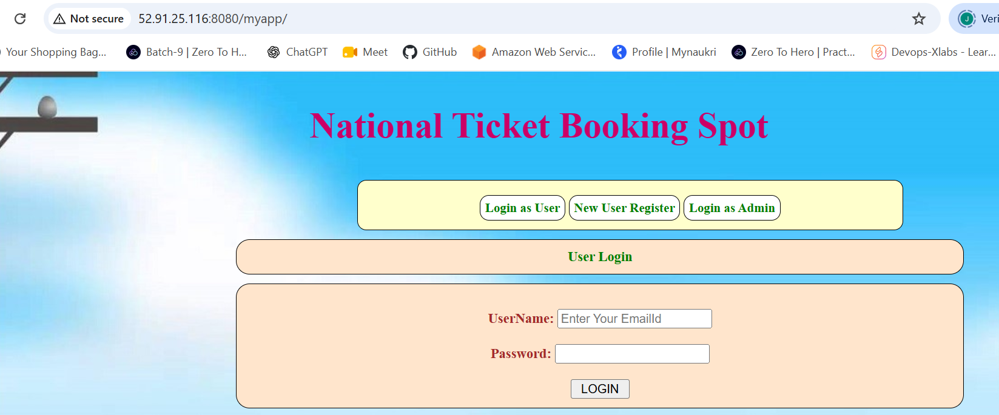
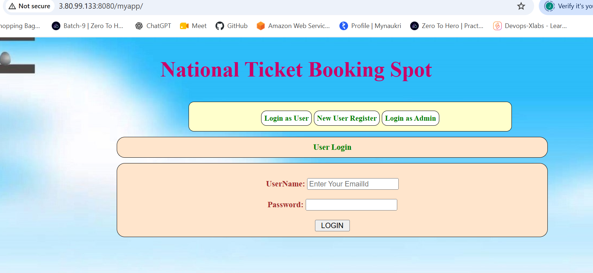

# Tomcat Multi-Environment CI/CD Deployment

## 1. Overview

This document describes the Tomcat deployment setup across four
environments:

-   **DEV** -- automatic deployment after a push to the configured
    deployment branch.
-   **TEST** -- deployment starts after DEV succeeds and requires
    approval.
-   **PREPROD** -- deployment starts after TEST succeeds and requires
    approval.
-   **PROD** -- deployment starts after PREPROD succeeds and requires
    approval.

The pipeline builds the WAR file once and promotes the same artifact
through each environment. Each environment has its own Tomcat EC2
instance, IP address, application URL, and GitHub Environment
configuration.

> **Important:** The workflow must use the exact branch name configured
> in its `on.push.branches` section (for example, `master` or `main`).
> The branch name in this document is descriptive; confirm it matches
> the actual workflow.

## 2. Architecture

``` text
                 Push to deployment branch
                            |
                            v
                     Build application
                     Maven: clean package
                            |
                            v
                    Upload WAR artifact
                            |
                            v
                     Deploy to DEV
                       Automatic
                            |
                            v
                     Deploy to TEST
                    GitHub approval
                            |
                            v
                   Deploy to PREPROD
                    GitHub approval
                            |
                            v
                     Deploy to PROD
                    GitHub approval
                            |
                            v
                    Deployment complete
```

Each deployment job selects a GitHub Environment. GitHub then makes that
environment's variables and secrets available to the job, subject to any
configured protection rules and approvals.

## 3. Environment configuration

Create these environments under:

**Repository → Settings → Environments**

  GitHub Environment   Purpose                     Approval
  -------------------- --------------------------- ----------------------
  `dev`                Development deployment      No required reviewer
  `test`               Test deployment             Required reviewers
  `preprod`            Pre-production validation   Required reviewers
  `prod`               Production deployment       Required reviewers

### 3.1 Environment variables

Configure the following variables separately in each GitHub Environment:

  -----------------------------------------------------------------------------
  Variable                Description             Example
  ----------------------- ----------------------- -----------------------------
  `TOMCAT_HOST`           Public or reachable     need to give based on the server IP
                          private IP/DNS name of  
                          that environment's EC2  
                          instance                

  `TOMCAT_USER`           SSH deployment account  `deploy`

  `TOMCAT_WEBAPPS`        Tomcat webapps          `/var/lib/tomcat10/webapps`
                          directory               

  `TOMCAT_SERVICE`        systemd service name    `tomcat10`

  `APP_URL`               Application             `http://host:8080/myapp/`
                          health-check URL        
  -----------------------------------------------------------------------------

Use the correct values for each environment. Do not use the example IP
addresses in production.

### 3.2 Environment secrets

Configure these secrets in each environment, or at repository level if
the same credential is intentionally shared:

  -----------------------------------------------------------------------
  Secret                              Description
  ----------------------------------- -----------------------------------
  `SSH_PRIVATE_KEY`                   Private key matching the public key
                                      installed in the `deploy` user's
                                      `authorized_keys`

  `SSH_KNOWN_HOSTS`                   Verified host-key entries for the
                                      EC2 host(s) that the workflow may
                                      contact
  -----------------------------------------------------------------------

The private key must never be copied to an EC2 instance or committed to
the repository.

A single combined `SSH_KNOWN_HOSTS` value can contain entries for DEV,
TEST, PREPROD and PROD. The host key for each instance must be verified
independently. The hostname/IP in each entry must match the value used
by `TOMCAT_HOST`.

## 4. EC2 and AMI configuration

### 4.1 DEV instance provisioning

The Tomcat provisioning script is run on the DEV EC2 instance. It:

1.  Installs OpenJDK 17, Tomcat 10 and OpenSSH server.
2.  Creates the `deploy` Linux user if it does not already exist.
3.  Installs the deployment **public** SSH key into the deploy user's
    `authorized_keys`.
4.  Generates SSH server host keys.
5.  Configures Tomcat webapps directory permissions for the deployment
    group.
6.  Configures restricted passwordless sudo commands for Tomcat service
    restart and status checks.
7.  Enables and starts the Tomcat service.
8.  Writes deployment configuration and a host-key entry under
    `/etc/tomcat-deploy/`.

The matching private key is stored as the GitHub Actions secret
`SSH_PRIVATE_KEY`.

### 4.2 Creating the AMI

Before creating the reusable AMI:

1.  Validate Tomcat, SSH login, deployment permissions and service
    restart on DEV.
2.  Run the provisioning script's `prepare-ami` mode.
3.  Confirm the instance-specific SSH host keys have been removed.
4.  Stop the DEV instance and create the AMI.

The deployment user's `authorized_keys` should remain in the image. Do
not bake a private SSH key into the AMI.

### 4.3 Launching TEST, PREPROD and PROD

Launch each environment from the AMI, then verify that cloud-init
generates a new unique SSH host key on first boot.

On each instance:

``` bash
sudo ssh-keygen -lf /etc/ssh/ssh_host_ed25519_key.pub
```

Compare fingerprints. DEV, TEST, PREPROD and PROD must not share the
same SSH host identity.

If cloud-init does not regenerate host keys as expected, correct the
image's first-boot configuration and test again before using the AMI for
production.

## 5. SSH known_hosts management

`known_hosts` is used by the GitHub Actions runner to verify the
identity of the EC2 server. It is **not** copied to the EC2 server.

For each instance:

1.  Obtain the server's SSH host public key through a trusted channel,
    such as EC2 console/SSM or direct inspection on the instance.
2.  Obtain its fingerprint:

``` bash
sudo ssh-keygen -lf /etc/ssh/ssh_host_ed25519_key.pub
```

3.  Collect the host-key entry for the IP/DNS name used by
    `TOMCAT_HOST`.
4.  Verify the collected key fingerprint matches the trusted
    fingerprint.
5.  Combine the verified entries into one `known_hosts` file.
6.  Store the file contents in the GitHub secret `SSH_KNOWN_HOSTS`.

`ssh-keyscan` can collect a presented key, but it does not authenticate
that key. Do not trust its output until the fingerprint has been
independently verified.

When an instance is replaced or its host key is regenerated, update the
corresponding entry. If only the IP changes but the host key remains the
same, update the hostname/IP field in the entry.

## 6. GitHub Actions deployment flow

The workflow should:

1.  Trigger on a push to the configured deployment branch.
2.  Check out the repository.
3.  Set up Java 17.
4.  Build the WAR with Maven.
5.  Upload the WAR as a workflow artifact.
6.  Deploy DEV automatically.
7.  Deploy TEST after DEV succeeds and the TEST environment approval is
    granted.
8.  Deploy PREPROD after TEST succeeds and PREPROD approval is granted.
9.  Deploy PROD after PREPROD succeeds and PROD approval is granted.
10. Run an application health check after deployment.

The WAR should be built once and downloaded by each deployment job. This
ensures the same artifact is promoted through all environments.

### 6.1 Environment selection in each job

Each deployment job must specify its own GitHub Environment:

``` yaml
deploy-dev:
  environment:
    name: dev

deploy-test:
  environment:
    name: test

deploy-preprod:
  environment:
    name: preprod

deploy-prod:
  environment:
    name: prod
```

Use the same variable names in each environment. GitHub resolves the
values from the environment associated with the job.

### 6.2 Approval configuration

For TEST, PREPROD and PROD:

1.  Open **Repository → Settings → Environments**.
2.  Select the environment.
3.  Add the appropriate required reviewers.
4.  Save the protection rule.

When the workflow reaches a protected environment, the deployment job
waits for an authorized reviewer. After approval, GitHub makes the
protected environment's secrets available and allows the job to
continue.

DEV should have no required reviewer if it is intended to deploy
automatically.

## 7. Tomcat deployment and validation

The deployment account is `deploy`. The Tomcat service runs under the
package's Tomcat service account.

Typical deployment directory:

``` text
/var/lib/tomcat10/webapps
```

Typical service:

``` text
tomcat10
```

Example deployment operations on the EC2 host:

``` bash
cp /tmp/myapp.war /var/lib/tomcat10/webapps/myapp.war
sudo systemctl restart tomcat10
sudo systemctl is-active tomcat10
```

Validate the application:

``` bash
curl --fail --show-error http://YOUR_HOST:8080/myapp/
```

A successful HTTP response confirms the endpoint responded. Also inspect
Tomcat logs if deployment or application startup fails.

## 8. images and deployment evidence

The images below are **evidence placeholders**. Replace them with
actual images from your GitHub Actions runs and GitHub Environment
approval pages. No live GitHub images were supplied when this
README was created, so no images are represented as actual
deployment evidence.

Create a `images/` directory beside this README and save the
images using these filenames.

### 8.1 GitHub approval pending\


**File:** `images/approval-pending.png`

Capture the GitHub Actions deployment job waiting for approval for TEST,
PREPROD or PROD.



### 8.2 GitHub approval granted

**File:** `images/approval-approved.png`

Capture the GitHub Actions deployment job after an authorized reviewer
approves the deployment.



### 8.3 DEV deployment output

**File:** `images/dev-deployment.png`

Capture the DEV deployment job showing artifact download, SSH/SCP
deployment and successful health check.



### 8.4 TEST deployment output

**File:** `images/test-deployment.png`

Capture the TEST deployment job after approval and successful
deployment.



### 8.5 PREPROD deployment output

**File:** `images/preprod-deployment.png`

Capture the PREPROD deployment job after approval and successful
deployment.



### 8.6 PROD deployment output

**File:** `images/prod-deployment.png`

Capture the PROD deployment job after approval and successful
deployment.


## 9. Operational checklist

### EC2 and Tomcat

-   [ ] Java 17 installed.
-   [ ] Tomcat installed and enabled.
-   [ ] `deploy` user created.
-   [ ] Deployment public key installed.
-   [ ] SSH login tested as `deploy`.
-   [ ] Tomcat webapps permissions tested.
-   [ ] Restricted sudo permissions validated.
-   [ ] Tomcat restart tested.
-   [ ] DEV AMI created after removing instance-specific host keys.
-   [ ] Unique SSH host-key fingerprints verified on all four instances.

### GitHub

-   [ ] `dev`, `test`, `preprod` and `prod` environments created.
-   [ ] Environment variables configured correctly.
-   [ ] `SSH_PRIVATE_KEY` configured securely.
-   [ ] Verified `SSH_KNOWN_HOSTS` configured.
-   [ ] DEV automatic deployment tested.
-   [ ] TEST approval tested.
-   [ ] PREPROD approval tested.
-   [ ] PROD approval tested.
-   [ ] Application health checks passed in all four environments.

## 10. Security considerations

-   Never commit private SSH keys, passwords or production secrets.
-   Never place a private SSH key in the AMI.
-   Use unique SSH host keys for every EC2 instance.
-   Verify host fingerprints independently; `ssh-keyscan` alone is not
    verification.
-   Restrict inbound SSH access to trusted runner/network addresses.
-   Restrict Tomcat service permissions to the commands required by
    deployment.
-   Use GitHub Environment protection rules for TEST, PREPROD and PROD.
-   Prefer a self-hosted runner or secure private connectivity when
    Tomcat EC2 instances are not publicly reachable.
-   Keep production approval rights limited to authorized reviewers.

------------------------------------------------------------------------

**Document status:** Deployment procedure and evidence template.

**Evidence status:** Actual approval and environment images must be
added after running the pipeline.

